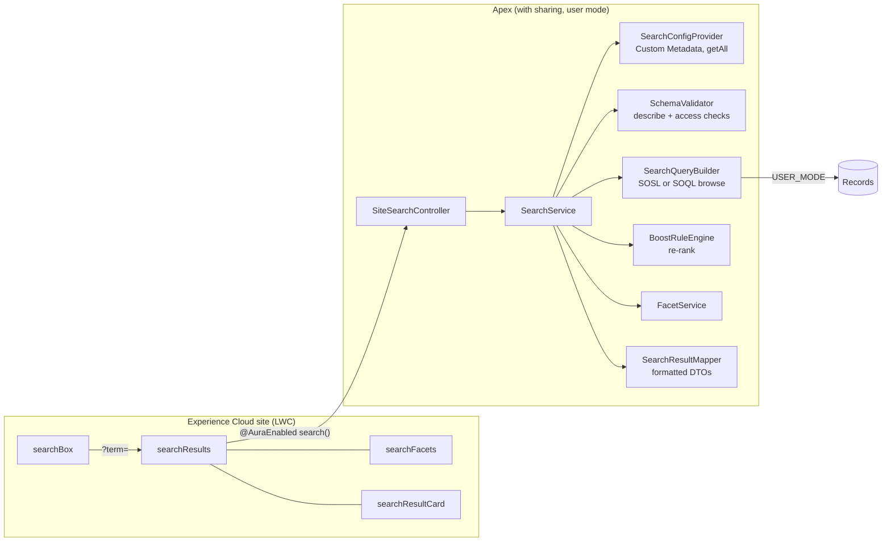

# Search Kit

**Free, admin-configurable search for Salesforce Experience Cloud sites.** Choose which objects and fields are searchable, add fixed filters, facets and **boost rules** that re-rank results by field value ("featured articles first"), all from Custom Metadata with no code. Runs entirely inside Salesforce (LWC + Apex), respects sharing and field-level security, and works for guest users.

## Why

Standard Experience Cloud search is hard to tune: admins can't easily say "only published articles" or "featured items first". The usual alternative is a full paid search platform. Search Kit sits in between: a lightweight component that admins configure in Setup.

## Features

- **Search across several objects**, grouped by object, with a title, up to three detail fields and a link to each record.
- **Fixed filters** as structured rules (field, operator, value), e.g. `Status = Published`. No raw SOQL in configuration.
- **Boost rules** that re-rank results, e.g. `Featured is true → +50`. SOSL doesn't let you control ranking; this does.
- **Facets** on picklist, multi-select and checkbox fields, with or without a search term ("browse"). Selections are kept in the URL, so filtered results can be shared and the back button restores them.
- **Object tabs** like Salesforce's Experience Cloud search: an **All** tab plus one tab per object (e.g. only Cases), kept in the URL. On All, "View all" opens an object's tab; on an object tab, **Load more** grows that list.
- **Agentforce action:** agents search with the same configurations, filters and boosts, for configs an admin has opted in. See [Use with Agentforce](#use-with-agentforce).
- **Knowledge articles** next to other objects: always published versions only, in the visitor's site language, optionally restricted to a data category. See [Knowledge](#knowledge).
- Loading, empty and error states.
- **Experience Builder friendly:** a search box for the header, a results component, and a picklist of your search configurations in the property panel. Works on **LWR** and **Aura** sites.
- **Guest users and logged-in customers:** every query runs as the visitor. The [Guest user setup](#guest-user-setup) section covers exactly what to grant.
- **Accessible:** keyboard-friendly, a live region announces result counts, focus is managed after "Load more", a collapsible filter panel (collapsed by default, it stays in place across tabs), and axe checks in every component test.
- **Translatable:** every visible string is a Custom Label.

## How boost scoring works

SOSL returns records in relevance order but offers no way to influence it. Search Kit keeps that order as a baseline and adds the points of every boost rule a record matches:

```
score     = baseScore + sum of points of the boost rules the record matches
baseScore = resultCount - position        (position 0 = SOSL's most relevant record)
```

With 10 results, the most relevant record has a base of 10 and the least relevant a base of 1. A featured article (+50) at position 8 scores 3 + 50 = 53 and moves above the plain top match (10). Equal scores keep SOSL's order, so the sort is stable, and negative points demote. The formula lives in one method, `BoostRuleEngine.score`, with table-style unit tests.

Boosts can only re-rank records the query returned, so each object fetches a larger pool than it shows: three pages of candidates (at most 200), ranked together and then cut to one page. A featured record that SOSL puts on page 2 or 3 still reaches page 1. "Load more" keeps the results already on screen in place and appends the next ones, so nothing a visitor has read moves.

In the demo, searching **password** moves the featured "Your first login" article from last place (score 1) to first (61).

## Architecture



1. The search box sends the visitor to the search page with `?term=`.
2. The results component calls one Apex method with the configuration name, term, facet selections and page size.
3. The service loads the configuration (Custom Metadata, no query limits used), validates every object and field against the schema and the visitor's access, and builds **one SOSL query** for a term, or **SOQL per object** when only facets are selected.
4. Results are re-ranked with the boost rules, mapped to display-ready values (picklist labels, locale-formatted dates) and returned with the facet definitions.

**Configuration** is five Custom Metadata types: `Search_Config__mdt` → `Search_Object__mdt` → `Search_Filter_Rule__mdt`, `Search_Boost_Rule__mdt`, `Search_Facet__mdt`. Details are in [docs/SPEC.md](docs/SPEC.md).

## Install

**Version 1.0.0** (unlocked package, no namespace):

- [Install in production or a Developer Edition org](https://login.salesforce.com/packaging/installPackage.apexp?p0=04tgK000000aIrFQAU)
- [Install in a sandbox](https://test.salesforce.com/packaging/installPackage.apexp?p0=04tgK000000aIrFQAU)

Or with the Salesforce CLI:

```bash
sf package install -p 04tgK000000aIrFQAU -o <your-org> -w 20
```

Choose **Install for Admins Only**, then give access with the two permission sets (see below). Try it in a sandbox first.

Requirements: Experience Cloud enabled, and an LWR or Aura site.

## Configure your first search

This walkthrough searches **Cases**. The values in steps 2–4 are **example data**: enter your own objects, fields and values. Any standard or custom object works the same way.

1. **Permissions.** Assign yourself **Site Search Kit Admin** (read access to the configuration types). Editing Custom Metadata records in Setup also needs **Customize Application**.
2. **Create a configuration.** Setup → Custom Metadata Types → **Search Config** → Manage Records → New: Label `Help Center Search`, Results Per Object `10` (1–50), Active ✓.
3. **Add a searchable object.** **Search Object** → New, for example:
   - Search Config: `Help Center Search`
   - Object: `Case`
   - Title Field: `Subject`
   - Detail Field 1–3: e.g. `CaseNumber`, `Status`, `AccountId`. A lookup field shows the related record's name (`AccountId` shows the account name, `OwnerId` the owner's or queue's name), labelled without "ID" ("Account"). If the visitor can't read the related object or its name, or can't see that record, the detail is left out; IDs are never shown.
   - Section Label: `Cases`
   - Icon Name: `standard:case`
   - Sort Order: `1`
   - Active ✓

   Object and field values are **API names**; they are validated at run time, and invalid entries are skipped and logged.

4. **Optional rules** on that Search Object:
   - **Search Filter Rule:** always applied, e.g. Field `Status`, Operator `not_equals`, Value `Closed`. All rules on an object are combined with AND. An invalid filter rule hides the whole object rather than showing unfiltered records.
   - **Search Boost Rule:** e.g. Field `Priority`, Operator `equals`, Value `High`, Points `20`. Negative points demote.
   - **Operators** (both rule types; the value is checked against the field type when the search runs):

     | Operator                      | Field types                              | Value                                                                     |
     | ----------------------------- | ---------------------------------------- | ------------------------------------------------------------------------- |
     | `equals`, `not_equals`        | all except multi-select                  | one value                                                                 |
     | `in`                          | text, picklist, multi-select, number, Id | several values separated by `;`, e.g. `New;Working`. Multi-select: any of |
     | `includes`                    | multi-select picklist                    | one value                                                                 |
     | `greater_than`, `less_than`   | number, date, date/time                  | one value                                                                 |
     | `is_true`, `is_false`         | checkbox                                 | none                                                                      |
     | `is_blank`, `is_not_blank`    | all except checkbox                      | none                                                                      |
     | `contains` (boost rules only) | text, picklist                           | text to find, ignoring case                                               |

     Date and date/time values: `2026-01-31`, `2026-01-31T09:00:00Z`, or a relative date: `TODAY`, `YESTERDAY`, `LAST_N_DAYS:n`, `NEXT_N_DAYS:n` (n from 0 to 9999). A relative date means **one day**, worked out in the visitor's time zone when the search runs, and the operator compares with it: `Published Date greater_than LAST_N_DAYS:30` means "published in the last 30 days, today included". This differs from SOQL, where `LAST_N_DAYS:30` is a range. On date/time fields, relative dates work with `greater_than` and `less_than` and compare whole days.

   - **Search Facet:** a picklist, multi-select or checkbox field, e.g. `Status`, with an optional Label and Sort Order. Values that a filter rule on the same field rules out aren't offered (with a filter `Status in New;Working`, the Status facet shows only New and Working); multi-select facets are never narrowed.
5. **Add the components in Experience Builder:**
   - Create a page for results (for example "Search") and drop **Site Search Results** on it. Pick `Help Center Search` in the property panel; **Show filters** and **Show object tabs** are on by default.
   - Drop **Site Search Box** in the header. Set **Search page API name** to that page's API name, shown in its Page Properties (for example `Search__c` on LWR, `Site_Search__c` on Aura). If it doesn't match, searching shows "Invalid page".
   - **Aura sites whose header has a built-in search slot** (for example the Customer Service template's Compact Header): the slot only lists Aura search components, so use **Site Search Box (Aura Header)** instead. In Experience Builder, open the theme layout's settings (Theme panel) and set **Search Component** to **Site Search Box (Aura Header)**. Then select the box in the header and set **Search page API name** as above (default `Site_Search__c`). On Aura, give the results page its own name; the template's standard Search page reads its term differently and doesn't work with Site Search Results.
6. **Give visitors access.** Assign **Site Search Kit User** to the people who search, plus Read on the objects and fields you configured. For guests and customers, follow [Guest user setup](#guest-user-setup).
7. **Publish** the site and search. Records created in the last few minutes may not show up for a search term yet: Salesforce indexes new records for search in the background (a filter-only "browse" finds them right away).

## Security

All queries run in **user mode** from `with sharing` classes, so object permissions, field-level security and sharing always apply. Object and field names reach a query only after schema validation, and every visitor input is sanitized or type-checked and bound. Configuration holds structured rules, never raw WHERE clauses, and record data is rendered as text only. Salesforce Code Analyzer reports **0 security findings**. Full details: [docs/SECURITY.md](docs/SECURITY.md).

## Try the demo

The repository includes a complete demo: a fictional software company's **customer support portal** with known issues, Knowledge articles in English and Spanish, cases, a guest-visible search, a logged-in customer and an Agentforce agent. You can build it in a scratch org in about 5 minutes.

### Build the demo scratch org

**Prerequisites:** [Salesforce CLI](https://developer.salesforce.com/tools/salesforcecli), Node.js LTS, and a Dev Hub authorized as your default (`sf org login web -d -a devhub`).

The steps take a few minutes (about 3 minutes of org work, plus `npm install`). Run them from the repo root:

```bash
# 1. Install dev tooling (lint, Prettier, Jest)
npm install

# 2. Create a scratch org with Experience Cloud and Agentforce enabled
sf org create scratch -f config/project-scratch-def.json -a sskit -d -y 30

# 3. Create the demo LWR site first: the deploy in step 5 fills in its pages
#    (runs in the background, usually under a minute)
sf community create --name "Support Portal" --template-name "Build Your Own (LWR)" --url-path-prefix support templateParams.AuthenticationType=AUTHENTICATED_WITH_PUBLIC_ACCESS_ENABLED

# 4. Wait until the site appears in this query
sf data query -q "SELECT Name, Status FROM Network"

# 5. Deploy the search metadata, the demo metadata and the site's pages.
#    First make yourself a Knowledge user (deploying the Knowledge languages needs it),
#    then the Knowledge languages and the data category group (the profiles in the full
#    deploy refer to the group, and one deploy doesn't create it first).
#    --ignore-conflicts is needed because the site's template pages from step 3
#    count as org changes; this deploy is meant to replace them.
sf apex run -f scripts/setup-knowledge-user.apex
sf project deploy start -m Settings:Knowledge -m DataCategoryGroup:Products
sf project deploy start --ignore-conflicts

# 6. Give yourself access to the config types and the demo object
sf org assign permset -n Site_Search_Kit_Admin -n Support_Demo_Admin

# 7. Load 28 sample known issues, accounts, contacts and cases
sf data import tree -p data/sample-data-plan.json

# 8. Set up the site's visitors: guest access, plus a demo customer (Priya Raman).
#    Also dates three issues in the last 30 days for the "recent" boost; rerun to refresh.
#    Creates and publishes 11 Knowledge articles in English and Spanish.
node scripts/setup-demo-users.js

# 9. Publish the site
sf community publish --name "Support Portal"

# 10. Activate the site, so visitors can reach it (it starts "Under Construction").
#     If it says "unable to obtain exclusive access", the publish is still running:
#     wait a minute and run it again.
sf data update record -s Network -w "Name='Support Portal'" -v "Status=Live"

# 11. Optional: the Agentforce demo agent (agent user, publish, activate)
node scripts/setup-demo-agent.js
```

To check the demo config, open **Setup → Custom Metadata Types → Search Config → Manage Records**. You should see "Support Portal Search".

### Try it

`sf org open` logs you in to the org.

- **As a guest:** open the site's public URL in a private window, search for **password** in the header, and open a result. You see 4 **Known Issues**, the featured one first, and no cases; a fifth, unconfirmed report (status New) never shows. Open **Filters** (collapsed by default) and tick a **Product**, **Status** or **Severity** to narrow the results, or open the search page with no term and pick a filter to browse. **Status** offers only the confirmed statuses, because the config filters out New. Search for **invoice**: guests see 2 issues, because two billing issues aren't marked **Visible to Guests**. Right after step 8, guest searches can return nothing for a few minutes (see below).
- **Knowledge, as a guest:** the same **password** search has a **Knowledge Base** section with two articles. The demo also has an internal-only article, a customers-only article, a draft and an archived version about passwords; none of them show. On the **Knowledge Base** tab the filter panel stays in place and says there are no filters for it. Pick **Español** in the header and search **contraseña** to get the Spanish article instead.
- **Ask the agent** (after step 11): `sf agent preview --api-name Support_Search_Agent --use-live-actions`, then "How do I reset my password?". It answers from the Knowledge how-to and the known issue about delayed reset emails, with its status and workaround: content a guest can see, nothing more.
- **As a customer:** in the org, open the contact **Priya Raman** and choose **Log in to Experience as User**. Search for **password** again: you also see the cases of her account (Brightwater Logistics), but not other accounts' cases. The filter panel now has a **Status** filter under **My Cases**, next to the known issue filters. Search **dashboard** and pick **Closed** to find her closed case. **invoice** returns all 4 billing issues. Under **Knowledge Base**, **password** also finds "Password policy for business accounts", which is published for customers only.

## Guest user setup

Experience Cloud guests (visitors who aren't logged in) get no access by default. For the search to work for them, an admin sets up four things. The demo does all of this in `demo/` and `scripts/setup-demo-users.js`; in your own org, do it in Setup:

1. **Apex access:** assign the **Site Search Kit User** permission set to the site's guest user. Without it, the search shows "The Apex request is invalid." The guest user is named "_Site Name_ Site Guest User" (Setup → Users; its profile is "_Site Name_ Profile").
2. **Object and field access:** in a permission set assigned to the guest user (or the guest profile), give **Read** on every object in your search configuration and on every field the configuration uses (title, details, filter, boost and facet fields). Leave out objects guests shouldn't see: an object without Read access is simply skipped. The demo's `Support_Demo_Guest` grants `Known_Issue__c` and Knowledge only, so guests never see cases.
3. **Record access:** guest users' org-wide default is always **Private** (Secure Guest User settings), so share records with a **guest user sharing rule** (Setup → Sharing Settings → the object → New, rule type "Guest user access, based on criteria"). The demo shares `Known_Issue__c` where `Status` isn't New (the issue is confirmed) **and** the opt-in checkbox `Visible to Guests` is ticked, so a new issue stays hidden from guests until someone decides otherwise. Sharing rules are the real security boundary; the search configuration's filter rules only decide what appears in results.
4. **Record pages (only if search results link to Lightning record pages):** standard record components load data through the UI API, which guests can't call by default; the page shows blank and the browser logs `401` errors on `ui-api` requests. Turn on **Allow guest users to access public APIs** (Experience Builder → Workspaces → **Administration → Preferences**). The search component itself doesn't need it. **Security note:** this lets anyone call the API for records the guest can read, and it's the setting abused in 2026's guest-data scraping campaigns. Only enable it when step 3 shares nothing you wouldn't publish. The guest profile does **not** need **API Enabled**.

Then check as a guest in a private browser window. **Allow a few minutes after a new sharing rule:** the search index applies sharing changes later than queries do. In testing, browsing by filter showed the shared records right away, while search terms returned nothing for about 6 minutes.

### Logged-in site users

Customers who log in need the same things, granted differently:

1. **Site Search Kit User** plus object and field Read, through permission sets.
2. **Records:** Customer Community users have no roles, so they can't be given sharing rules. Use a **sharing set** (the demo's `Support_Portal_Customers` shares cases by account) or set the object's external org-wide default to Read. The demo uses Read for `Known_Issue__c`; the search config's filter (`Status` in Investigating, Fix in Progress, Resolved) keeps unconfirmed reports out of results.
   - **Optional hardening:** Read also lets a customer open an unconfirmed (New) issue by direct link. To block that, add a **restriction rule** on the object (Object Manager → the object → Restriction Rules): user criteria "Profile ID equals" the customer profile, record criteria `Status != New`. Create it in Setup: in testing, rules deployed as active metadata failed with an internal error, while activating the same rule in Setup worked. Restriction rules accept the profile only by ID, which is why the demo can't ship one.
3. **Site membership:** their profile must be a member of the site (Experience Builder → Administration → Members). The demo script adds `Support_Portal_Customer`.

## Knowledge

Lightning Knowledge articles can be searched next to other objects. Add a Search Object with **Object API Name** set to your article object (usually `Knowledge__kav`; any object ending in `__kav` is treated as Knowledge), **Title Field** `Title`, and details such as `Summary`. Results link to the article's page on the site (`/article/<url-name>`), on LWR and Aura.

**What the search always adds** (not configurable, so a configuration can't expose drafts by mistake):

- **Published versions only** (`PublishStatus = 'Online'`): never drafts or archived versions.
- **The visitor's language.** The component sends the site's current language, because Apex sees a guest user's own language, not the one picked on the site. It's used if it's an active Knowledge language, or if its base language is (`es_MX` becomes `es`); otherwise the user's own language is tried. If neither is a Knowledge language, a term search uses Salesforce's default Knowledge language, and a filter-only browse leaves Knowledge out rather than showing every language.

**Restrict to a data category (optional).** On the Search Object, set **Data Category Group** (e.g. `Products`), **Data Category** (e.g. `Nimbus_Cloud`) and **Data Category Operator** (**At**, or **At or Below**, the default). Both names are checked against the categories the visitor can see. If the visitor can't see the category (including the parent of one they can see), Knowledge is left out of their results rather than searched without the restriction. A Knowledge object with a category runs as its own SOSL query, because Salesforce applies a category to a whole query; that's one extra query per search.

**Who sees which articles.** Salesforce enforces article visibility itself; set up these, in addition to [Guest user setup](#guest-user-setup):

1. **Object and field Read** on the article object (e.g. `Knowledge__kav` and `Summary`) in a permission set for guests and customers.
2. **Channels:** guests see articles published to **Public Knowledge Base** (`IsVisibleInPkb`), customers those for **Customer** (`IsVisibleInCsp`). New articles are internal only by default.
3. **Data category visibility** on the guest profile, the customer profile or a role (Setup → Data Category Visibility). Permission sets can't carry it in metadata; the demo ships it as small profile files. Users without visibility see only articles that have no category.
4. **Article page:** a site created before Knowledge was turned on has none. Add one in Experience Builder: Pages → New Page → **Object Pages → Knowledge**. Guests also need **Allow guest users to access public APIs** to open it (see the security note in [Guest user setup](#guest-user-setup), step 4). On the Aura Customer Service template, guests see a "feature is not currently enabled" message from one of the template's article page components; closing it shows the article.
5. **Languages:** the site's languages (Experience Builder → Settings → Languages) should match the Knowledge languages (Setup → Knowledge Settings).

**With an agent:** the agent user sees the internal channel too, so add a filter rule `IsVisibleInPkb is true` to an agent config's Knowledge object, as the demo's `Support_Agent_Search` does. A category restriction also needs category visibility for the agent user (the demo grants it on the Einstein Agent User profile).

## Use with Agentforce

The **Search Site Content** action (`SiteSearchAction`, an Apex invocable action) lets an Agentforce agent search with a search configuration: the same objects, filters, boosts and validation as the site. It returns a short numbered summary for the agent plus structured results (record Id, object, type, title, details). Errors come back as a message the agent can relay, not as a failed turn.

**Who the search runs as.** A service agent runs its actions as its **agent user**, not as the person chatting (tested: the action's Apex ran as the agent user). So the agent can find whatever the agent user can read, and it may tell anyone what it found. Two safeguards:

1. **Opt in per config.** The action only uses configs with **Allow Agent Access** ticked (off by default); for any other config it answers "This search isn't available to agents." Opt in configs whose results you'd publish, typically public content.
2. **Give the agent user only what it may share.** Assign **Site Search Kit Agent** (the action) and Read on the objects and fields the config uses, nothing more. Filters still apply: a config's filters can't be skipped by the agent.

**Set up in your org**

1. Make or pick a config with only shareable content and tick **Allow Agent Access**. The demo's `Support_Agent_Search` searches known issues that are confirmed **and** Visible to Guests, plus public Knowledge articles about Nimbus Cloud (see [Knowledge](#knowledge)), so the agent says nothing a guest couldn't read on the site. The site's own config stays off.
2. Assign **Site Search Kit Agent** and object/field Read to the agent user.
3. In Agentforce Builder (or Agent Script), add the action to a topic and set **Search Configuration** to your config's API name as a fixed value, so the agent can't pick another one. The demo agent in `demo/main/default/aiAuthoringBundles/Support_Search_Agent` shows the instructions and inputs.

**Limits.** Up to 10 results per search (default 5), mixed across objects by rank (each object's best result, then the second best, and so on), and up to 10 searches per call, as long as the transaction has SOSL queries left (a search uses one, or two with a Knowledge category). Results don't include a link yet. Tested with a **service agent** through `sf agent preview`; employee agents and an agent embedded on an Experience Cloud site haven't been tested.

## Repository layout

| Path         | Contents                                                                                                                                                                                               | Packaged? |
| ------------ | ------------------------------------------------------------------------------------------------------------------------------------------------------------------------------------------------------ | --------- |
| `force-app/` | Search configuration metadata types, Apex search service, LWCs, labels, permission sets                                                                                                                | Yes       |
| `demo/`      | Demo-only metadata: `Known_Issue__c`, Knowledge settings and data categories, sample search configs, the Support Portal site's pages, the Agentforce demo agent, permission sets, sharing and profiles | No        |
| `scripts/`   | Sample data generator; demo setup (guest access, demo customer, agent user and demo agent)                                                                                                             | No        |
| `data/`      | Sample records for `sf data import tree` (generated by `scripts/generate-sample-data.js`)                                                                                                              | No        |
| `config/`    | Scratch org definition                                                                                                                                                                                 | No        |
| `docs/`      | Spec, progress log with tested platform findings, security notes, setup notes, backlog                                                                                                                 | No        |

## Development

```bash
npm run lint          # ESLint for LWC/Aura (force-app and demo)
npm run test:unit     # LWC Jest tests, including axe-core accessibility checks
npm run prettier      # format
sf apex run test -l RunLocalTests -c -r human -w 10
sf code-analyzer run --workspace force-app
```

## Roadmap

Planned for later versions (see [docs/BACKLOG.md](docs/BACKLOG.md)):

- Facet value counts, prefix search, a site link in agent results.

## License

[MIT](LICENSE)
